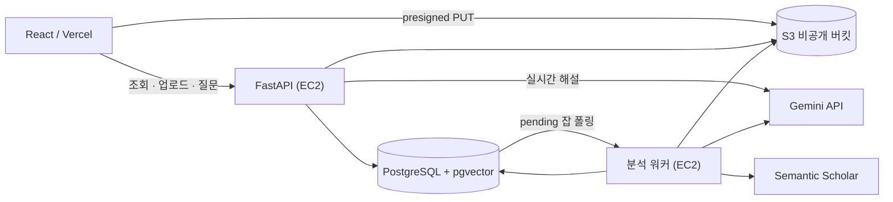

# 아키텍처

## 전체 구성



프론트는 Vercel, 나머지는 EC2 한 대에 docker compose로 올린다.
FastAPI와 워커는 같은 이미지를 쓰고 실행 커맨드만 다르다.

API 서버는 HTTP 요청만 처리한다. 무거운 건 전부 워커로 넘긴다. 다만 학생이 직접 던지는
질문은 예외로, API 서버가 Gemini를 바로 호출한다. 잡 큐를 거치면 폴링 지연이 그대로
체감되기 때문이다.

API 서버와 워커는 서로를 호출하지 않는다. `analysis_job` 레코드를 통해서만 주고받는다.
업로드를 받은 API가 잡을 만들어 두면 워커가 집어가고, 진행 상태를 같은 레코드에 쓴다.
프론트는 API로 그 상태를 폴링한다.

## 업로드 흐름

PDF는 서버를 거치지 않는다. 브라우저가 S3로 직접 PUT한다.

1. 프론트가 과목·파일명·크기를 보내면 API가 `document` 레코드를 만들고 presigned PUT URL을 준다
2. 브라우저가 S3에 직접 업로드한다
3. 프론트가 완료를 알리면 API가 S3에 객체가 실제로 있는지, 크기가 맞는지 확인하고 분석 잡을 만든다
4. 워커가 잡을 집어가 분석한다
5. 프론트는 2~3초 간격으로 상태를 폴링한다

3번의 재확인이 중요하다. 서버를 거치지 않으니 클라이언트 말만 믿을 수 없다.
presigned URL을 만들 때 Content-Type과 크기 상한을 조건으로 걸어 둔다.

## 분석 파이프라인

워커가 잡을 집으면 네 단계를 순서대로 돈다.

**parse** — S3에서 PDF를 받아 Docling으로 페이지 구조를 뽑는다. 본문, 표, 그림,
블록 좌표가 나온다. 좌표를 남겨 두는 이유는 나중에 질문을 원문 위치로 되돌리기 위해서다.
단순 텍스트 추출이면 이게 안 된다.

여기서 표지, 목차, 감사합니다 같은 페이지를 걸러낸다. 텍스트 길이와 위치로 1차 판단하고
애매한 건 Gemini에 물어본다. 걸러낸 페이지도 지우지 않고 사유를 적어 둔다. 기준을
나중에 바꿀 때 어떤 페이지가 왜 빠졌는지 봐야 하기 때문이다.

**analyze** — Gemini로 페이지별 개념과 요약을 뽑는다. 여기서 "이 슬라이드가 어디까지
설명하는가"를 같이 적게 한다. 자료에 안 나온 내용을 학생이 모른다고 단정하면 안 되고,
설명 범위 밖은 확장 주제 후보로 다뤄야 하기 때문이다.

페이지 하나씩 호출하면 호출 수가 너무 많아지니 여러 장을 묶어서 보낸다.
몇 장씩 묶을지는 실제 자료로 토큰 수를 재 보고 정한다.

**generate** — 세 가지를 만든다.

- 질문: 유효 슬라이드마다 두세 개. 다섯 관점 중 맞는 것만 고른다. 만든 다음 중복이나
  슬라이드 범위를 벗어난 걸 걸러낸다.
- 후속 과목 연결: 페이지 개념을 임베딩해서 pgvector로 과목 개념 후보를 찾고,
  그중 실제로 연결되는 걸 Gemini가 고르고 근거를 쓴다. 검색은 임베딩, 판단은 LLM이다.
  임베딩만 쓰면 단어가 비슷한 쪽으로 끌려간다.
- 연구 동향: 동향이 켜진 과목만. Semantic Scholar로 논문을 찾고 Gemini가 요약한다.

**validate** — 형식만 본다. JSON이 스키마에 맞는지, 참조하는 페이지·블록·과목 ID가
실제로 있는지, 논문 링크가 살아 있는지, 중복이 없는지. 내용이 맞는지는 여기서 판단하지
않는다. 그건 관리자 검수와 별도 품질 평가에서 한다.

각 단계가 끝나면 결과를 커밋하고 어디까지 했는지 기록한다. 3단계에서 실패해 재시도해도
Docling을 다시 돌리지 않는다.

## 잡 큐

브로커 없이 PostgreSQL 테이블로 한다. 워커는 `pending` 잡을 폴링한다.

```sql
UPDATE analysis_job
SET status = 'running', locked_by = :worker_id, locked_at = now(),
    attempt = attempt + 1
WHERE id = (
    SELECT id FROM analysis_job
    WHERE status = 'pending' AND scheduled_at <= now()
    ORDER BY scheduled_at, id
    FOR UPDATE SKIP LOCKED
    LIMIT 1
)
RETURNING *;
```

`SKIP LOCKED` 덕분에 워커를 여러 개 띄워도 같은 잡을 두 번 처리하지 않는다.
획득이 UPDATE 한 문장이라 경쟁 조건도 없다.

상태는 `pending → running → succeeded / failed`. 일시적인 실패(타임아웃, 5xx, 429,
LLM 출력이 스키마에 안 맞는 경우)는 `scheduled_at`을 뒤로 밀어 `pending`으로 되돌린다.
백오프는 30초에서 시작해 두 배씩, 최대 10분. 세 번 넘게 실패하면 `failed`로 두고
관리자가 다시 넣을 수 있게 한다. 손상된 PDF나 없는 S3 객체처럼 다시 해도 소용없는
건 바로 실패시킨다.

워커가 죽으면 잡이 `running`에 남는다. 워커는 단계마다 `locked_at`을 갱신하고,
이 값이 오래된 잡은 주기적으로 `pending`으로 회수한다. 타임아웃은 가장 긴 단계보다
넉넉하게 잡아야 정상 동작 중인 잡을 뺏지 않는다. 일단 15분으로 두고 실측 후 조정한다.

워커 동시성은 1로 시작한다. Docling이 메모리를 많이 써서 그렇다. 사양이 확보되면
프로세스를 늘려도 되고, 아예 다른 인스턴스로 빼도 된다. 큐가 DB에 있어서 분리 비용이 낮다.

## 데이터 모델

구현하면서 바뀔 테니 전체 스키마 대신 덩어리와 관계만 적는다.

커리큘럼 선택과 수강 지도는 프론트 화면 작업 전까지 보류한다. [구현 계획](curriculum-plan.md)을 참고한다.

**교육과정 쪽(공용)** — `curriculum`, `course`, `course_relation`, `course_concept`,
`syllabus`, `course_alias`. 관리자가 등록하고 모든 학생이 공유한다.

`course_relation`에는 공식 교육과정에 있는 선수·후속 관계와 시스템이 추천한 연결이
같이 들어간다. `source` 컬럼으로 구분하고 화면에서도 다르게 보여 준다. 이 구분이
흐려지면 "공식적으로 이어지는 과목"과 "AI가 비슷하다고 본 과목"이 섞여서 신뢰를 잃는다.

`course.is_trend_enabled`로 과목별 동향 기능을 켜고 끈다.

**문서 쪽(사용자별)** — `document` → `document_page` → `page_analysis`, `page_concept`.
업로드한 본인만 본다. 강의자료는 교수 저작물이라 공유하지 않는다.

**생성 결과** — `question`(유형, 본문, 추천 이유, 사전 지식, 학습 순서, 첫 활동,
원문 위치), `page_course_link`, `research_trend` + `page_trend_link`.

동향은 과목 단위로 캐시하고 페이지와의 연결만 문서별로 만든다. 같은 과목의 다른
학생이 검색 결과를 재사용하게 하려는 것이다. Semantic Scholar 호출을 줄이는 게 목적이고,
캐시 유효기간은 일단 30일로 본다.

**개인 기록** — `saved_question`, `user_note`, `ai_conversation` / `ai_message`.
저장 목록에서 고르면 그 질문이 달린 PDF 페이지로 돌아간다.

**운영** — `analysis_job`, `job_step_log`, `validation_result`, `admin_review`,
그리고 `llm_usage_log`.

`llm_usage_log`에는 사전 생성인지 학생 질문인지를 구분하는 컬럼을 둔다.
검증 계획에 두 비용을 나눠 기록한다는 항목이 있어서 필요하다.

임베딩은 전부 1536차원으로 맞춘다. 이유는 [decisions.md](decisions.md)에 적었다.

## API

전부 `/api/v1` 아래. 주요한 것만.

```
POST /documents/upload-url        presigned PUT URL 발급
POST /documents/{id}/complete     업로드 확인 후 분석 잡 생성
GET  /documents/{id}/status       분석 진행 상태 (폴링 대상)
GET  /documents/{id}/file-url     열람용 presigned GET URL

GET  /pages/{id}/questions        슬라이드 기본 질문
GET  /pages/{id}/related-courses  후속 과목 연결과 근거
GET  /pages/{id}/trends           연결된 연구 동향
POST /pages/{id}/ask              개별 질문 (Gemini 실시간)

GET  /courses/{id}/map            과목 지도
```

조회 경로에서는 LLM을 부르지 않는다. 실시간 호출은 `/ask` 계열뿐이다.
이 선이 무너지면 사전 생성의 의미가 없어진다.

다른 사용자의 문서에 접근하면 403이 아니라 404로 응답한다. 존재 여부를 노출하지 않는다.

presigned GET URL은 만료된다. PDF를 오래 열어 두면 중간에 로딩이 깨지므로
프론트가 `file-url`을 다시 받아 복구할 수 있어야 한다.

## 프론트

핵심 화면은 PDF 뷰어다. 본문 옆에 질문을 띄우고, 누르면 추가 학습 패널이 열린다.
패널을 열거나 닫을 때 읽던 위치를 잃으면 안 된다. PDF 컴포넌트가 리마운트되지 않게
상태를 바깥에 둬야 한다.

서버 상태는 TanStack Query로 관리한다. 분석 상태 폴링은 `refetchInterval`로 걸고
완료나 실패에서 멈춘다. API 호출은 `src/api`에만 두고 컴포넌트에서 직접 fetch하지 않는다.
