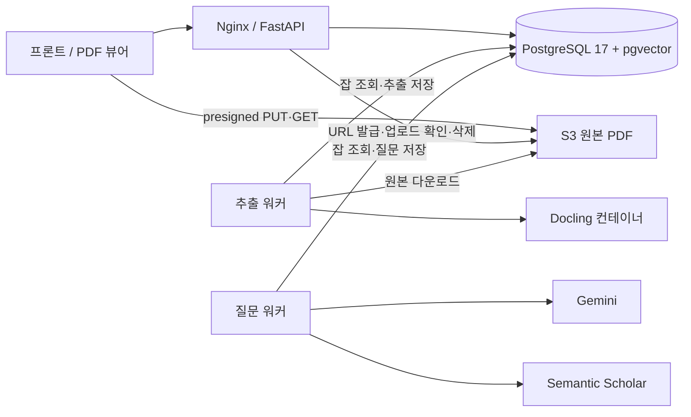

# 아키텍처

현재 백엔드 구현 기준이다. 프론트에서 사용하는 경로·요청·응답은 [API 명세](api.md)에 모았다.

## 구성



EC2에서 API·워커·DB를 Docker Compose로 실행한다. API와 워커는 같은 배포 이미지의
서로 다른 진입점이다. 추출 워커와 질문 워커를 하나씩 실행한다. Docling은 별도 CPU 이미지로 실행하며 같은 버전의 추출 코드를 사용한다.
API는 HTTP 요청을 처리하고, 워커는 PostgreSQL의 `analysis_job`에서 작업을 가져온다.
API와 워커가 직접 통신하거나 Redis를 사용하는 구조는 아니다.

프론트는 원본 PDF를 받아 페이지 단위로 표시한다. 페이지 이미지를 S3에 따로 저장하지 않는다.
질문·메모·열람 위치는 JSON API로 다룬다. 조회 API는 저장된 결과를 읽으며 Gemini를 호출하지 않는다.
`/ask`는 현재 페이지의 원문과 서버에 저장된 본인의 최근 대화 3쌍으로 Gemini를 직접 호출한다.
원문만 쓰므로 추출이 끝나면 질문 생성을 기다리지 않고 답한다.
답변의 근거 ID를 같은 페이지의 블록과 대조한 뒤 질문·답변을 함께 저장한다.
페이지를 다시 열면 채팅 조회 API로 이전 대화를 복원한다.

## PDF 처리

1. 업로드 URL 발급 시 사용자·과목에 연결된 `document`를 `pending_upload`로 만든다.
2. 브라우저가 S3에 PDF 바이트를 PUT한다. 서버에 파일을 다시 전송하지 않는다.
3. `/complete`가 S3 객체의 존재와 실제 크기를 확인하고 문서를 `uploaded`로 바꾼다.
   같은 트랜잭션에서 분석 잡을 생성한다. 이때부터 원본 PDF를 열람할 수 있다.
4. 추출 워커가 사용자별로 PDF 한 개씩 순환하며 Docling으로 페이지·블록·텍스트·표·좌표를 추출한다.
   사용자 안에서는 실행 가능한 문서를 접수 순서로 고른다. 추출 JSON, 전체 페이지 수, 페이지 행을
   저장하면 다른 사용자에게 차례를 넘긴다. 추출 차례와 질문 생성 차례는 따로 기록한다.
5. 질문 워커가 추출한 텍스트와 표 셀을 3페이지씩 Gemini에 전달해 요약·개념·질문·해설을 만든다.
   표지 등 제외 페이지도 원래 번호와 제외 사유를 유지한다. 적격 페이지에는 질문을 정확히 2개 만든다.
6. 형식·질문 수·페이지 내 중복 질문·참조 ID를 검증하고, 과목·논문 연결까지 끝난 묶음마다
   질문 행·생성 결과 JSON·진행률을 함께 저장한다. 모든 페이지가 저장되면 잡을 성공으로 바꾼다.
   내용의 사실성까지 자동으로 보장하는 검증은 아니다.

사용자별 순환, 최근 열람 PDF의 우선 배정, 실패한 묶음의 공개 여부와 예외는
[PDF 추출과 질문 생성 처리 규칙](analysis-scheduling.md)에 정리했다.

진행률은 3페이지 묶음이 끝날 때마다 기록한다. 처리한 페이지 수에는 제외 페이지도 포함된다.
완료한 페이지의 질문은 분석 도중에도 공개된다. 프론트는 원본을 먼저 보여 주고 `/status`를 폴링하며,
완료 페이지 수가 늘면 현재 페이지의 `/learning`과 열린 질문 목록을 갱신한다.
미완료 페이지의 `/learning`은 409이고, 제외 페이지는 질문 없는 완료 결과를 반환한다.
Gemini 설정이 없으면 추출만 저장하고 `succeeded/analysis_skipped`로 끝난다.

추출 설정은 OCR·페이지 이미지 생성을 끄고 CPU 1스레드, 표 구조 분석과 셀 매칭을 사용한다.
현재 Gemini에는 그림 이미지 자체를 보내지 않는다. 상세 설정과 추출 계약은
[추출 문서](extraction/README.md), 컬럼별 저장 방식은 [저장 구조](extraction/storage.md)를 따른다.

## 데이터 관계

`curriculum` 안에 `course`, 과목 안에 사용자가 올린 `document`, 문서 안에 `document_page`가 있다.
과목의 커리큘럼 소속은 비어 있을 수 있다. 문서에는 커리큘럼 ID를 중복 저장하지 않는다.
문서·질문·메모는 업로드한 본인만 접근하며, 타인 자원은 404로 응답한다.

| 데이터 | 실제 테이블 |
| --- | --- |
| 계정·갱신 토큰 | `user`, `refresh_token` |
| 공용 커리큘럼·과목·과목 간 관계 | `curriculum`, `course`, `course_relation` |
| 사용자 수강 상태 | `user_course` |
| 원본 파일 정보·페이지 번호 | `document`, `document_page` |
| 추출 원문·공개 결과·미완료 묶음 | `document_learning`의 `extraction`, `result`, `pending_batch` JSONB |
| 질문·해설·근거 좌표·추천 결과 | `question` |
| 질문 저장 표시·페이지 메모 | `saved_question`, `user_note` |
| 사용자별 페이지 채팅 질문·답변·응답 유형·근거 ID | `page_chat` |
| 마지막 페이지·서로 다른 열람 페이지 | `user_document_progress`, `user_page_view` |
| 과목 검색용 주제·편성 학기·1536차원 임베딩 | `course_learning_profile` |
| 질문 검색어별 연구 동향 캐시 | `research_query_cache` |
| 이전 버전의 과목 단위 연구 동향 캐시 | `course_research_cache` |
| 처리 단계·진행률·실패·실행 잠금 | `analysis_job` |

`document_learning.result`와 `question`은 같은 질문 UUID를 사용한다. 질문 저장 여부와 추천 과목의
수강 상태는 조회 시점의 사용자 기록을 붙인다. 생성 결과에 저장된 과거 상태를 그대로 노출하지 않는다.

수강 중·완료는 사용자가 직접 지정한다. 열람 진도는 서로 다른 열람 페이지 수 / 전체 페이지 수이며,
페이지가 실제 표시될 때 별도 PUT으로 기록한다. GET은 진도를 바꾸지 않고, 열람률 100%도 수강 완료를
자동으로 설정하지 않는다. 과목 진도는 본인이 업로드 완료한 PDF들만 합산한다.

## 과목 연결과 연구 동향

추천 과목은 같은 커리큘럼의 `course_learning_profile`을 pgvector로 검색한 뒤 Gemini가 고른다.
`previous`·`next`는 편성 학기의 앞뒤 관계이고, 사용자가 실제로 수강했는지는 `enrollment_status`로
별도 표시한다. 추천 결과는 공식 선수과목 관계가 아니다. 커리큘럼 지도는 `course_relation`에 등록된
관계를 보여 주며 질문별 추천과 구분한다.

연구 동향은 `course.is_trend_enabled`가 켜진 과목만 생성한다. 같은 페이지의 두 질문이 같은 연구 주제면
검색어 하나로 묶고, 주제가 다를 때만 각각 영어 검색어를 만든다. Semantic Scholar 검색 결과는 Gemini가
초록에 근거해 요약하고 `과목 + 정규화된 검색어`별로 30일간 재사용한다. 각 질문에는 자신이 속한
검색어의 후보만 전달하며, 직접 관련된 후보가 없으면 빈 목록을 저장한다. 검색 오류가 남은 묶음은
공개하지 않고 재시도한다. 성공한 검색 캐시는 유지한다. 질문과 과목·논문 연결 결과는 함께 공개한다.

Semantic Scholar 로그는 워커 표준 출력에 JSON 한 줄씩 남긴다. 문서·잡·과목 ID, 페이지 번호,
검색어와 UTC 시각으로 추적한다. `semantic_scholar_request_started`와
`semantic_scholar_request_finished`는 `search_id`와 `request_attempt`로 짝지으며,
종료 이벤트의 `status`로 성공·실패를 센다. 시작만 있는 호출은 중단 여부를 확인해야 한다.
`elapsed_ms`는 한 번의 요청과 응답 처리 시간이고, `search_elapsed_ms`는 같은 검색의 재시도 대기를
포함한 누적 시간이라 마지막 종료 이벤트 값만 사용한다. 실패에는 HTTP 오류 코드, 오류 내용,
재시도 여부와 예정 대기 시간을 남긴다. 성공의 `paper_count`는 검증을 통과한 논문 수다.
`semantic_scholar_cache`의 `status`는 검색어 캐시의 hit/miss이며, `source`가 `checkpoint`이면
캐시 miss여도 저장한 검색 응답을 재사용하므로 API를 호출하지 않는다. 이 로그는 DB에 저장하지
않으며, 현재 Docker 설정에서는 컨테이너를 교체하면 이전 로그가 사라진다.

## 실패와 복구

워커는 `FOR UPDATE SKIP LOCKED`로 잡을 하나씩 가져온다. 실행 중 30초마다 잠금을 갱신하고,
15분간 갱신이 없는 잡은 회수한다. 실행마다 다른 잠금 소유자를 사용해 이전 워커의 늦은 저장을 막는다.

Gemini의 일시적인 통신 오류는 해당 호출만 5초·15초·30초 뒤 재시도한다. 그래도 실패하면
미완료 묶음을 대기시켜 다른 문서에 차례를 넘긴다. 질문 초안·검색어·성공한 검색 응답은 내부에 저장해
재사용한다. 묶음이 성공하면 연속 실패 기록을 초기화하고, 같은 묶음이 1시간 동안 복구되지 않으면
일시 중단한다. 간격과 누적 시도 횟수는 [처리 규칙](analysis-scheduling.md#대기와-실패)을 따른다.
실패하거나 분석이 생략된 문서는 사용자가 `/retry`로 다시 요청할 수 있다.
완료한 질문의 UUID·저장 표시·메모·열람 기록은 유지한다. 성공한 질문의 재생성이나 PDF 교체 API는 없다.

삭제는 실행 대기·처리 중인 잡이 없을 때만 가능하다. S3 원본을 먼저 지운 뒤 문서에 속한
페이지·질문·저장 표시·메모·채팅·열람 기록·분석 결과·잡을 DB에서 함께 지운다. 두 저장소는 하나의
트랜잭션이 아니므로 S3 삭제 후 DB 삭제가 실패하면 같은 DELETE를 재요청한다.

## 데이터 준비와 남은 범위

숭실대학교 AI소프트웨어학부 2026학년도 교육과정은 [과목 연결 그래프](course-graph/README.md)를 사용한다.
계정의 커리큘럼 선택 저장, 학기별 수강 이력과 분반 선택은 아직 제공하지 않는다.

DB 연결과 환경 변수를 준비한 뒤 `backend/`에서 실행한다. 마이그레이션만으로 과목 데이터가 들어가지는 않는다.

```sh
alembic upgrade head
python -m app.scripts.seed_ssu_curriculum
```

과목 추천용 자료는 대상 커리큘럼을 등록한 뒤 `python -m app.services.curriculum_search <corpus.zip> --curriculum-id <UUID>`로 넣는다.
경영학부 시연 커리큘럼은 `python -m app.scripts.seed_curricula`로 등록한다.
파일로만 질문 생성을 확인할 때는 `python -m app.pipelines.learning_cli <extraction.json> -o <learning.json> --env-file ../.env`를 사용한다.
CLI 결과 예시는 [learning.example.json](examples/learning.example.json)이며 HTTP 응답과 달리 질문 UUID·저장 여부가 없다.
