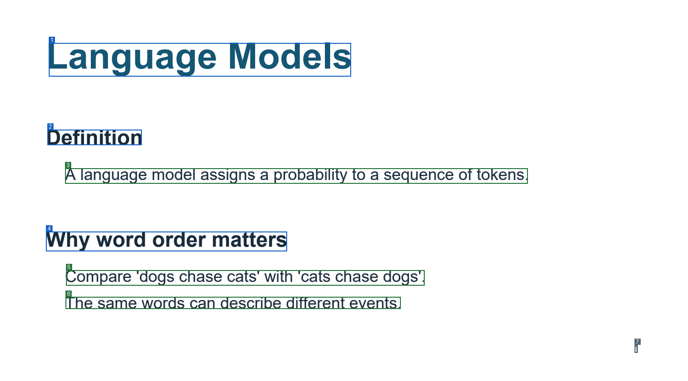

# PDF·강의계획서 데이터 형식

이어봄에서 문서 추출기, 질문 생성기, PDF 뷰어 사이에 교환하는 v1.0 형식이다. 스키마는 JSON Schema Draft 2020-12이고, 예시는 팀 내 통합 테스트용 가상 자료다. 저장소의 [분석 파이프라인](../architecture.md#분석-파이프라인)을 따른다.

| 형식 | 스키마 | 예시 |
| --- | --- | --- |
| 강의자료 PDF | [pdf.schema.json](pdf.schema.json) | [pdf.example.json](pdf.example.json) |
| 강의계획서 | [syllabus.schema.json](syllabus.schema.json) | [syllabus.example.json](syllabus.example.json) |

## 시연 데이터

[공개 시연 데이터 ZIP](demo/ieobom-ssu-corpus.zip)을 내려받아 압축을 푼다. 2026학년도 입학생 기준 교육과정 52과목과 2026학년도 개설 정보, 과목당 대표 계획서에서 정리한 49과목의 주차별 주제가 들어 있다. U-SAINT 로그인 없이 사용할 수 있다.

1. `manifest.json`의 `course_index`에서 과목 인덱스 경로를 확인한다.
2. 인덱스에서 `course_id`로 과목을 찾고, `syllabus.path`가 있으면 ZIP 루트 기준으로 해당 JSON을 읽는다.
3. 해당 JSON의 `weekly_topics`에서 주차별 주제를 읽는다. `syllabus`가 비어 있는 과목은 `syllabus_status`를 확인한다.

공개용 주차별 주제 JSON은 과목 탐색과 검색 시연용이다. 원본 PDF와 페이지 근거가 필요한 시연은 팀 자료를 사용한다. PDF에서 `block_id`로 위치를 찾는 방법은 아래 좌표 표시 예시를 참고한다.

## PDF

- `document_id`는 백엔드 문서 식별자다. `source.sha256`에는 원본 파일 바이트의 SHA-256을 기록한다. 예시의 해시와 파일명은 가상 값이다.
- `page_number`는 원본 PDF의 물리적 페이지 순서이며 1부터 시작한다. 표지나 빈 페이지도 원래 페이지 번호를 유지한다. 배열은 오름차순이고 페이지 번호는 문서 안에서 고유하다.
- `block_id`는 저장된 추출 결과 하나에서 고유하다. 다시 추출하거나 파서 버전이 바뀌면 재할당될 수 있다. 여러 페이지나 영역에 걸친 항목은 영역마다 별도의 블록으로 기록한다.
- `bbox`는 `[left, top, right, bottom]`이다. 원점은 페이지의 좌상단이고, 오른쪽과 아래쪽으로 값이 증가한다. x는 페이지 너비, y는 페이지 높이로 나눈 0~1 값이다. 가로·세로 화면 크기에 각각 곱해 화면 위치를 얻는다. 뷰어에서 추가로 회전시키면 좌표에도 동일한 회전을 적용한다. `width_pt`와 `height_pt`는 추출 좌표의 기준이 된 페이지 크기다.
- `kind`는 팀 공통 분류이고 `docling_label`은 Docling의 원래 분류다. 추출할 텍스트가 없는 그림처럼 위치만 있는 블록은 `text: null`로 표현한다. 표의 셀은 0부터 세고 끝 인덱스는 포함하지 않는다. 예를 들어 `row_start: 0, row_end: 2`는 첫 두 행을 덮는다.
- `analysis`는 페이지 분석이 끝난 뒤에 추가한다. `coverage`는 원문이 설명한 범위이며 `evidence_block_ids`에는 같은 페이지의 블록을 넣는다. 질문을 생성하지 않을 페이지도 결과에 남기고 `exclusion_reason`을 기록한다. 질문 생성기는 `document_id`, `page_number`, `block_id`를 반환하고 뷰어는 해당 블록에서 좌표를 조회한다.
- `warnings`는 부분 실패나 확인이 필요한 추출 결과를 전달한다. 페이지에 국한된 문제에는 `page_number`를 같이 넣는다.

## 강의계획서

- `course.course_id`는 교육과정과 강의자료에서 함께 사용하는 내부 식별자다. `course_code`에는 원문 학수번호를 넣는다. `curriculum_year`는 교육과정 적용 연도, `term`은 실제 강의계획서 학기·분반이다. 원문에서 확인되지 않는 단일 값은 `null`로 표시한다.
- `sources`는 강의계획서와 교육과정의 출처를 등록한다. PDF 출처의 `document_id`로 PDF 추출 결과를 연결하고, 웹 출처에는 원문 URL을 넣는다. `evidence`는 출처 ID와 원문 위치 또는 인용을 보존한다. PDF에는 페이지 번호, 가능하면 블록 ID를 넣고 웹에는 섹션명 또는 인용을 넣는다.
- `weekly_topics`는 원문에 적힌 주차별 내용이다. `concepts`는 검색에 사용할 개념과 그 근거이며, 확인된 주차가 있으면 `weeks`에 연결한다.
- `official_prerequisites`는 원문에 명시된 선수과목이다. 해당 정보가 없으면 `null`, 원문에 선수과목이 없다고 명시되어 있으면 `[]`를 사용한다. `suggested_connections`에는 추천 근거를 함께 기록한다.
- 자동 추출한 초안의 `verification_status`는 `needs_review`로 시작한다. 담당자가 원문과 대조한 뒤 `verified`로 바꾼다.

JSON Schema는 필드의 구조와 범위를 검증한다. 페이지·블록·출처 ID의 고유성, 참조가 가리키는 대상, 좌표와 표 셀 인덱스의 순서, 인용의 원문 일치는 통합 단계에서 별도로 확인한다.

## PDF 추출 및 좌표 확인

저장소 루트에서 Python 3.11 이상의 환경으로 실행한다. 처음 추출할 때 Docling이 레이아웃과 표 인식 모델을 다운로드한다.

```sh
python -m pip install -r backend/requirements-pdf.txt
python -m backend.app.pipelines.pdf_extraction extract lecture.pdf -o tmp/extraction/lecture.json
python -m backend.app.pipelines.pdf_extraction overlay lecture.pdf tmp/extraction/lecture.json -o tmp/extraction/overlay --page 1
python -m backend.app.pipelines.pdf_extraction overlay lecture.pdf tmp/extraction/lecture.json -o tmp/extraction/selected --block-id p0001-b0002
```

- `extract`는 Docling에서 얻은 페이지 크기, 읽기 순서의 블록, 표 셀, 좌상단 기준 좌표를 JSON으로 저장한다. `--document-id`로 DB의 문서 ID를 전달할 수 있다. 로컬 실행의 기본값은 파일의 SHA-256이다.
- 원본의 한 페이지만 검증하려면 `extract`에 `--page 5`를 붙인다. 결과의 `page_number`와 `block_id`에는 원본의 5쪽 번호가 유지된다. Docling 기본 PDF 백엔드가 로드되지 않는 환경은 `--pdf-backend pdfium`으로 Docling의 표준 레이아웃 분석을 실행할 수 있다. 표 셀 분석이 필요 없는 페이지에는 `--no-table-structure`를 추가한다.
- 텍스트 레이어가 없는 스캔은 `extract`에 `--ocr`를 추가한다. EasyOCR의 한국어·영어 모델을 CPU에서 사용한다. 스캔 여부를 자동 판별해 재실행하지는 않는다.
- `overlay`는 입력 PDF의 SHA-256과 페이지 크기를 확인한 다음 `page-0001.png` 같은 검토 이미지를 저장한다. 박스의 숫자는 해당 페이지 JSON의 `blocks` 배열에서 1부터 센 순서다. `--page`를 반복하면 선택한 페이지만 출력한다. `--dpi`의 기본값은 144다.
- 질문이 가리키는 위치를 확인하려면 추출 JSON의 실제 `block_id`를 `--block-id`에 넘긴다. 여러 블록을 보려면 옵션을 반복한다. 해당 블록이 있는 페이지에 선택한 박스만 그린다. `--page`도 지정하면 모든 블록이 선택한 페이지 안에 있어야 한다. 두 옵션을 생략하면 전체 페이지의 박스를 그린다.
- `warnings`를 먼저 보고, 이미지에서 본문·표·그림과 박스가 일치하는지 확인한다. 기하 정보가 맞지 않아 표시할 수 없는 PDF는 오류를 반환한다.

Python 진입점은 `backend.app.pipelines.pdf_extraction.extract_pdf(Path(...), document_id=...)`다. 워커는 같은 코드의 CLI를 별도 Docling 컨테이너에서 실행하고 `/work/output/{job_id}.json`에 결과를 남긴다. DB 저장은 아직 연결되지 않았다. 현재 테이블과 저장 제안은 [DB 저장 검토](storage.md)에 정리했다. 강의계획서 예시는 수집·검수 단계에서 채울 데이터 형식을 보여 준다.

### 진행 상태 조회

프론트는 기존 `GET /api/v1/documents/{document_id}/status`를 2~3초 간격으로 조회한다. `job_status`가 `succeeded` 또는 `failed`이면 폴링을 멈춘다. 조회 요청이 분석을 실행하거나 새 잡을 만들지는 않는다.

기존 `document_id`, `status`, `job_status`에 `stage`, `completed_pages`, `total_pages`, `stage_progress_percent`를 추가했다. 업로드 완료 전에는 `status = pending_upload`, `job_status = null`, `stage = uploading`이다. S3 업로드 퍼센트는 서버가 아니라 브라우저에서 전송한 바이트로 계산한다.

| stage | 의미 |
| --- | --- |
| `uploading` | PDF 업로드 완료 확인 전 |
| `queued` | 워커 처리 대기 |
| `downloading` | 워커가 S3에서 PDF를 받는 중 |
| `extracting` | Docling 추출 중 |
| `analyzing` | 추출 JSON을 분석 함수에 전달한 상태 |
| `analysis_skipped` | 빈 분석 함수 실행 종료. 질문 생성은 생략됨 |

단계 변경은 DB에 커밋하므로 API의 별도 세션에서도 읽을 수 있다. 실패 시 `job_status = failed`로 바꾸고 실패한 `stage`는 유지한다. 단계 기록이 없던 기존 잡은 새 필드가 `null`이다.

```json
{
  "document_id": "6f3df340-e4e6-43b4-9fe0-a03d2b205099",
  "status": "uploaded",
  "job_status": "succeeded",
  "stage": "analysis_skipped",
  "completed_pages": 0,
  "total_pages": 24,
  "stage_progress_percent": null
}
```

위는 새 워커로 24쪽 PDF를 처리했을 때의 응답 예다. `total_pages`는 Docling 추출 완료 후 채운다. `completed_pages`는 분석 완료 페이지 수이며, 빈 분석에서는 0이다. `analyzing` 단계에서만 두 값으로 해당 단계의 퍼센트를 계산한다. 현재 Docling은 중간 완료 페이지 수를 전달하지 않으므로 `extracting`의 페이지 수와 퍼센트는 `null`이다. 전체 작업의 예상 퍼센트나 남은 시간을 뜻하지 않는다.

`document_analysis.analyze_document()`는 지금은 `[]`만 반환한다. Gemini를 호출하지 않으며 이 반환값을 파일이나 DB에 저장하지 않는다. 워커는 `succeeded / analysis_skipped`로 종료하므로 프론트도 질문 생성 완료로 표시하지 않는다. 빈 함수는 즉시 끝나서 폴링 사이에 `analyzing` 단계를 지나갈 수 있다. 화면에 모든 중간 상태가 반드시 보이도록 실행을 지연시키지는 않는다.

### Docling 실행 설정

`pdf_extraction.py`에서 Docling 2.150.0의 `PdfPipelineOptions`를 설정한다. CPU 1스레드를 사용하고 레이아웃·표·OCR 배치 크기, 단계 사이 큐, PDF 파서의 선행 페이지 버퍼를 각각 1로 둔다. 표는 `ACCURATE` 모드와 셀 매칭을 사용한다. OCR은 기본으로 끈다.

현재 계약에는 그림의 위치만 필요하므로 페이지·그림 이미지를 결과에 보관하지 않는다. 그림 설명·분류, 코드·수식 보강도 끈다. 그림과 수식 블록의 종류·좌표는 그대로 추출한다. 원문 표시는 S3의 PDF, 좌표 검토 이미지는 `overlay`를 사용한다.

Docling 변환 제한은 PDF당 600초, 워커의 컨테이너 실행 대기는 900초다. 컨테이너는 CPU 1개와 메모리 4GB로 제한한다. 이 제한 안에서 처리되는 PDF 크기와 한국어 OCR 품질은 실제 강의자료로 확인해야 한다. 옵션의 의미는 [Docling 공식 설정 안내](https://docling-project.github.io/docling/usage/advanced_options/)를 참고한다.

Docling 이미지는 `BACKEND_IMAGE`의 추출 코드를 복사한다. 배포에서는 Compose가 같은 배포 태그의 백엔드 이미지를 넘기며, 백엔드 이미지를 받은 뒤 Docling 이미지를 빌드한다. 로컬에서 Docker로 확인할 때는 저장소 루트에서 다음 순서로 실행한다.

```sh
docker build -t ieobom-backend:local backend
docker build -t ieobom-docling:local -f infra/docling/Dockerfile.docling infra/docling
docker run --rm --cpus 1 --memory 4g --memory-swap 4g -v "./infra/docling/input:/work/input:ro" -v "./infra/docling/output:/work/output" -v ieobom_docling_cache:/root/.cache ieobom-docling:local extract /work/input/lecture.pdf --output /work/output/lecture.json --document-id local-check
```

앞의 명령은 `infra/docling/input/lecture.pdf`를 읽는다. 실제 워커는 전체 PDF를 OCR 없이 처리하며 DB의 문서 ID를 전달한다. CLI는 부분 변환 결과를 경고와 함께 남길 수 있지만, 워커는 `partial_conversion` 경고가 있으면 실패로 처리한다. 페이지 누락은 추출기에서 오류로 처리한다.

기존 `docling_check.py`는 원시 Docling JSON과 페이지 PNG를 보는 점검용으로 남겨 둔다. 필요할 때 `docker run`에 `--entrypoint python`을 넣고 이미지 뒤에 `/app/docling_check.py`와 점검 인자를 전달한다. 서비스 추출 설정과 출력 형식은 위의 공통 추출기를 기준으로 한다.

### 좌표 표시 예시

문서용 예시 슬라이드에서 Docling이 추출한 블록 7개를 모두 표시했다. 각 박스의 숫자는 해당 페이지의 `blocks` 배열에서 1부터 센 순서다.



같은 슬라이드에 `--block-id p0001-b0003`을 적용하면 언어 모델의 정의가 있는 3번 블록에 박스가 표시된다.


