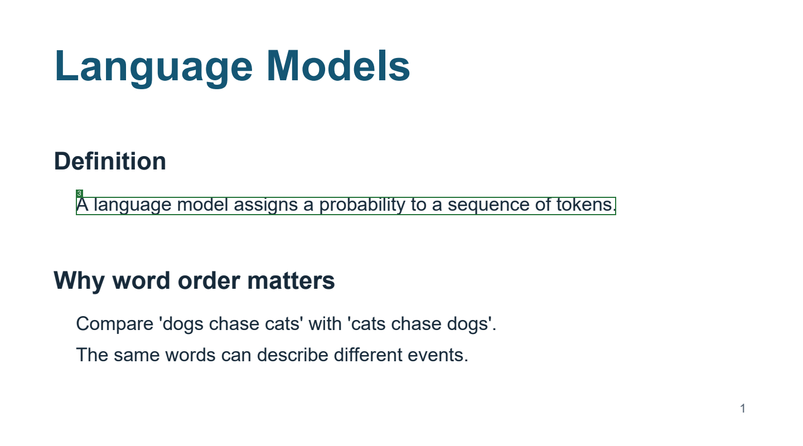

# PDF·강의계획서 데이터 형식

이어봄에서 문서 추출기, 질문 생성기, PDF 뷰어 사이에 교환하는 v1.0 초안이다. 스키마는 JSON Schema Draft 2020-12이고, 예시는 팀 내 통합 테스트용 가상 자료다. 저장소의 [분석 파이프라인](../architecture.md#분석-파이프라인)을 따른다.

| 형식 | 스키마 | 예시 |
| --- | --- | --- |
| 강의자료 PDF | [pdf.schema.json](pdf.schema.json) | [pdf.example.json](pdf.example.json) |
| 강의계획서 | [syllabus.schema.json](syllabus.schema.json) | [syllabus.example.json](syllabus.example.json) |

## PDF

- `document_id`는 백엔드 문서 식별자다. `source.sha256`에는 원본 파일 바이트의 SHA-256을 기록한다. 예시의 해시와 파일명은 가상 값이다.
- `page_number`는 원본 PDF의 물리적 페이지 순서이며 1부터 시작한다. 표지나 빈 페이지도 원래 페이지 번호를 유지한다. 배열은 오름차순이고 페이지 번호는 문서 안에서 고유하다.
- `block_id`는 저장된 추출 결과 하나에서 고유하다. 다시 추출하거나 파서 버전이 바뀌면 재할당될 수 있다. 여러 페이지나 영역에 걸친 항목은 영역마다 별도의 블록으로 기록한다.
- `bbox`는 `[left, top, right, bottom]`이다. 원점은 페이지의 좌상단이고, 오른쪽과 아래쪽으로 값이 증가한다. x는 페이지 너비, y는 페이지 높이로 나눈 0~1 값이다. 가로·세로 화면 크기에 각각 곱해 화면 위치를 얻는다. 뷰어에서 추가로 회전시키면 좌표에도 동일한 회전을 적용한다. `width_pt`와 `height_pt`는 추출 좌표의 기준이 된 페이지 크기다.
- `kind`는 팀 공통 분류이고 `docling_label`은 Docling의 원래 분류다. 추출할 텍스트가 없는 그림처럼 위치만 있는 블록은 `text: null`로 표현한다. 표의 셀은 0부터 세고 끝 인덱스는 포함하지 않는다. 예를 들어 `row_start: 0, row_end: 2`는 첫 두 행을 덮는다.
- `analysis`는 페이지 분석이 끝난 뒤에 추가한다. `coverage`는 원문이 설명한 범위이며 `evidence_block_ids`에는 같은 페이지의 블록을 넣는다. 질문을 생성하지 않을 페이지도 결과에 남기고 `exclusion_reason`을 기록한다. 질문 생성기는 `document_id`, `page_number`, `block_id`를 반환하고 뷰어는 해당 블록에서 좌표를 조회한다.
- `warnings`는 부분 실패나 확인이 필요한 추출 결과를 전달한다. 페이지에 국한된 문제에는 `page_number`를 같이 넣는다.

## 강의계획서

- `course.course_id`는 교육과정과 강의자료에서 함께 사용하는 내부 식별자다. `course_code`에는 원문 학수번호를 넣는다. `curriculum_year`는 교육과정 적용 연도, `term`은 실제 강의계획서 학기·분반이다. 원문에서 확인되지 않는 단일 값은 `null`로 표시한다.
- `sources`는 강의계획서와 교육과정의 출처를 등록한다. PDF 출처의 `document_id`로 PDF 추출 결과를 연결하고, 웹 출처에는 원문 URL을 넣는다. `evidence`는 출처 ID와 원문 위치 또는 인용을 보존한다. PDF에는 페이지 번호, 가능하면 블록 ID를 넣고 웹에는 섹션명 또는 인용을 넣는다.
- `weekly_topics`는 원문에 적힌 주차별 내용이다. `concepts`는 검색에 사용할 개념과 그 근거이며, 확인된 주차가 있으면 `weeks`에 연결한다.
- `official_prerequisites`는 원문에 명시된 선수과목이다. 해당 정보가 없으면 `null`, 원문에 선수과목이 없다고 명시되어 있으면 `[]`를 사용한다. `suggested_connections`에는 추천 근거를 함께 기록한다.
- 자동 추출한 초안의 `verification_status`는 `needs_review`로 시작한다. 담당자가 원문과 대조한 뒤 `verified`로 바꾼다.

JSON Schema는 필드의 구조와 범위를 검증한다. 페이지·블록·출처 ID의 고유성, 참조가 가리키는 대상, 좌표와 표 셀 인덱스의 순서, 인용의 원문 일치는 통합 단계에서 별도로 확인한다.

## PDF 추출 및 좌표 확인

저장소 루트에서 Python 3.11 이상의 환경으로 실행한다. 처음 추출할 때 Docling이 레이아웃과 표 인식 모델을 다운로드한다.

```sh
python -m pip install -r backend/requirements-pdf.txt
python -m backend.app.pipelines.pdf_extraction extract lecture.pdf -o tmp/extraction/lecture.json
python -m backend.app.pipelines.pdf_extraction overlay lecture.pdf tmp/extraction/lecture.json -o tmp/extraction/overlay --page 1
python -m backend.app.pipelines.pdf_extraction overlay lecture.pdf tmp/extraction/lecture.json -o tmp/extraction/selected --block-id p0001-b0002
```

- `extract`는 Docling에서 얻은 페이지 크기, 읽기 순서의 블록, 표 셀, 좌상단 기준 좌표를 JSON으로 저장한다. `--document-id`로 DB의 문서 ID를 전달할 수 있다. 로컬 실행의 기본값은 파일의 SHA-256이다.
- 원본의 한 페이지만 검증하려면 `extract`에 `--page 5`를 붙인다. 결과의 `page_number`와 `block_id`에는 원본의 5쪽 번호가 유지된다. Docling 기본 PDF 백엔드가 로드되지 않는 환경은 `--pdf-backend pdfium`으로 Docling의 표준 레이아웃 분석을 실행할 수 있다. 표 셀 분석이 필요 없는 페이지에는 `--no-table-structure`를 추가한다.
- 텍스트 레이어가 없는 스캔은 `extract`에 `--ocr`를 추가해 처리할 수 있다. 기본 OCR 설정으로 처리하며, 한국어 스캔은 팀 자료에 맞춰 OCR 엔진과 언어 설정을 검증해야 한다.
- `overlay`는 입력 PDF의 SHA-256과 페이지 크기를 확인한 다음 `page-0001.png` 같은 검토 이미지를 저장한다. 박스의 숫자는 해당 페이지 JSON의 `blocks` 배열에서 1부터 센 순서다. `--page`를 반복하면 선택한 페이지만 출력한다. `--dpi`의 기본값은 144다.
- 질문이 가리키는 위치를 확인하려면 추출 JSON의 실제 `block_id`를 `--block-id`에 넘긴다. 여러 블록을 보려면 옵션을 반복한다. 해당 블록이 있는 페이지에 선택한 박스만 그린다. `--page`도 지정하면 모든 블록이 선택한 페이지 안에 있어야 한다. 두 옵션을 생략하면 전체 페이지의 박스를 그린다.
- `warnings`를 먼저 보고, 이미지에서 본문·표·그림과 박스가 일치하는지 확인한다. 기하 정보가 맞지 않아 표시할 수 없는 PDF는 오류를 반환한다.

워커에서 호출할 진입점은 `backend.app.pipelines.pdf_extraction.extract_pdf(Path(...), document_id=...)`다. 함수가 반환한 딕셔너리를 저장하고 이후 분석 단계에서 페이지별 `analysis`를 추가한다. 강의계획서 예시는 수집·검수 단계에서 채울 데이터 형식을 보여 준다.

### 좌표 표시 예시

문서용 예시 슬라이드에서 Docling이 추출한 블록 7개를 모두 표시했다. 각 박스의 숫자는 해당 페이지의 `blocks` 배열에서 1부터 센 순서다.


같은 슬라이드에 `--block-id p0001-b0003`을 적용하면 언어 모델의 정의가 있는 3번 블록에 박스가 표시된다.


