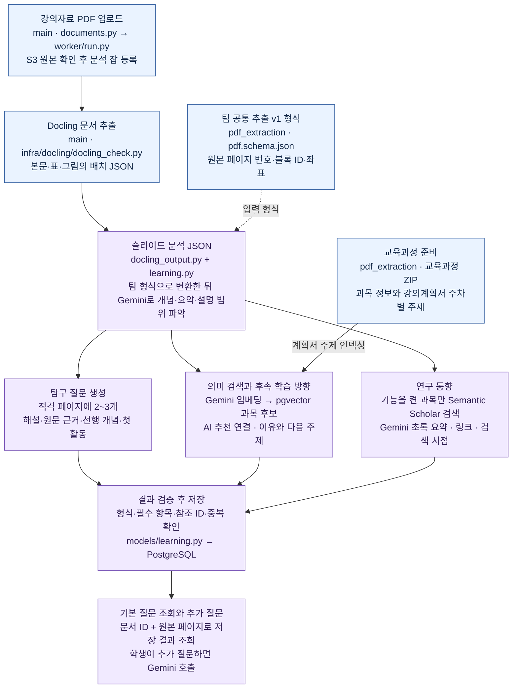
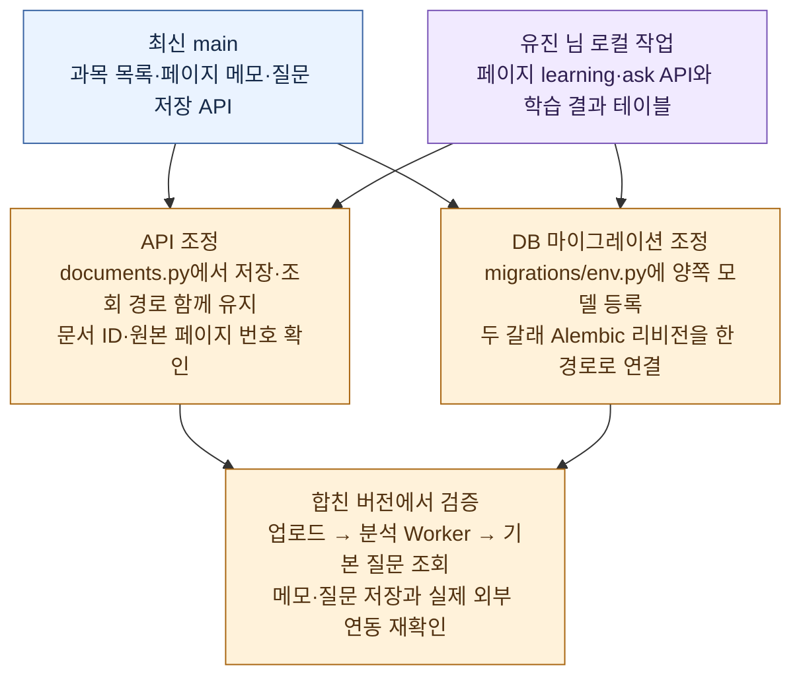

# 탐구 질문과 후속 학습 연동

업로드 완료 후 기존 워커가 Docling 결과를 팀의 추출 v1 형식으로 저장한다. 원본 페이지 번호, 블록 ID, 좌상단 기준 좌표를 유지한다. 생성 파이프라인은 `pdf_extraction` 브랜치의 추출 JSON도 입력으로 받는다. Gemini가 페이지 요약·설명 범위와 탐구 질문을 작성하고, 워커는 적격 페이지당 2~3개 질문과 실제 근거 블록을 검증한다. 표지 등 제외된 페이지는 제외 이유를 함께 저장한다. 질문은 학생이 스스로 던질 법한 의문문이며 추천 이유, 선행 개념, 학습 순서와 첫 활동을 담는다. 더 알아보기에 쓰는 해설·이어서 볼 과목·연구 동향도 질문마다 저장한다. 해설은 `explanation.headline`(한 줄 핵심), `explanation.body`(강의 근거와 이유), `explanation.flow`(개념이 이어지는 흐름 2~4단계)로 나눈다. 질문 수나 근거·과목·논문 참조 규칙을 어긴 응답은 해당 3쪽 묶음만 최대 세 번 다시 요청한다. 그래도 맞지 않거나 일시적 생성 오류가 나면 작업을 저장된 추출 결과에서 다시 시작한다.

교육과정 ZIP을 인덱싱하면 과목마다 계획서 주제 벡터와 가장 이른 편성 학기(`semester_order`, 3학년 2학기는 32)를 저장한다. 질문의 쪽 요약·개념 벡터로 pgvector를 두 번 조회해 이 과목보다 앞 학기 과목 3개와 뒤 학기 과목 3개를 후보로 만든다. 같은 학기 과목은 어느 쪽에도 넣지 않는다. Gemini는 질문마다 이 후보 안에서 과목을 고르고 연결 이유와 다시 볼 주제 또는 이어서 볼 주제(`next_topic`)를 쓴다. 각 과목의 `relation`은 `previous`(이전에 들은 관련 과목), `next`(이후에 들을 과목), `related`(이 과목의 학기 정보가 없을 때) 중 하나이고 `source`는 `ai_recommendation`이다. 교육과정 ZIP의 공식 선수과목(`official_prerequisites`)은 현재 52과목 모두 비어 있어 선수과목으로 표시하지 않는다. 검증된 공식 관계가 제공되면 별도 출처로 연결할 수 있다.

`course.is_trend_enabled`를 켠 과목은 Semantic Scholar 검색 결과에서 최근 5개 연도의 논문을 고른다. 초록 기반 요약과 원문 링크, 검색 시점을 30일 동안 과목 단위로 재사용한다. 페이지에는 관련 논문만 연결한다. `research_status`는 `disabled`, `ready`, `unavailable` 중 하나다. `ready`일 때도 해당 페이지에 맞는 논문이 없으면 목록은 비어 있다.

Semantic Scholar가 429 같은 오류로 응답하지 않으면 3초, 10초 뒤에 다시 시도한다. 그래도 실패하면 Gemini가 과목명과 계획서 주제로 연구 방향 3~5개를 정리한다. 이 항목은 `source: "gemini"`, `year: null`이며 논문 링크 대신 검색어로 만든 Google Scholar 검색 링크를 담는다. 없는 논문을 만들지 않도록 제목에는 연구 방향의 이름만 쓴다. 대체 결과는 캐시하지 않으므로 다음 분석에서 논문 검색을 다시 시도한다. Gemini도 실패하면 `unavailable`이다.

## 프런트엔드 연동

기존 로그인 토큰을 사용한다. 업로드 후 문서 상태를 폴링하고 `job_status=succeeded`이면 보고 있는 원본 PDF 페이지 번호(1부터 시작)로 조회한다.

| 메서드 | 경로 | 응답 |
| --- | --- | --- |
| GET | `/api/v1/documents/{document_id}/pages/{page_number}/learning` | 분석, 질문, 근거 좌표, 관련 과목, 연구 동향 |
| POST | `/api/v1/documents/{document_id}/pages/{page_number}/ask` | 추가 질문 해설과 근거 블록 ID |

GET은 DB에 저장된 결과를 읽는다. POST에는 `{"question":"함수 종속성을 다시 설명해 줘"}`처럼 본문을 보내면 Gemini가 그 페이지 자료를 근거로 답한다. 두 경로 모두 문서 소유권을 확인한다. 미생성 결과와 다른 사용자의 문서에는 404를 반환한다. 페이지 본문의 `evidence_blocks`를 `block_id`로 찾고 정규화 좌표에 렌더링 크기를 곱하면 원문 위치를 표시할 수 있다. 응답의 모든 필드와 화면별 사용 위치는 [learning-output.md](learning-output.md)에 정리했다.

## 실행 설정

- EC2에서는 기존 `~/ieobom/.env`에 DB·S3 설정과 `GEMINI_API_KEY`를 넣는다. 구성 변수는 저장소의 `.env.example`에 있다. Gemini 키가 비어 있으면 PDF 추출까지만 실행된다.
- API 컨테이너가 Alembic 마이그레이션을 끝내고 헬스체크에 응답하면 워커가 시작된다. 기존 Docling 도구 이미지를 호스트에 준비한다. 이미지가 없으면 배포 디렉터리에서 `docker compose --profile tools build docling`을 실행한다.
- 워커와 API에서 `generativelanguage.googleapis.com`에 HTTPS로 연결할 수 있어야 한다. 연구 동향을 사용하는 워커에는 `api.semanticscholar.org` 접근이 필요하다. `SEMANTIC_SCHOLAR_API_KEY`는 해당 서비스의 키를 발급받은 환경에서 설정한다.
- 과목 연결을 사용하려면 `pdf_extraction` 브랜치의 `docs/extraction/demo/ieobom-ssu-corpus.zip`을 한 번 인덱싱한다. 현재 사용 중인 과목은 과목 코드와 교육과정 연도로 매칭해 ID를 재사용한다. 임베딩 모델을 바꾸면 다시 인덱싱한다. 편성 학기 컬럼(`5d2e7a1c9b40` 마이그레이션)을 추가하기 전에 인덱싱했다면 이전·이후 과목을 나누도록 한 번 더 인덱싱한다.

```bash
docker compose exec -T worker sh -c 'cat > /tmp/ieobom-ssu-corpus.zip && python -m app.services.curriculum_search /tmp/ieobom-ssu-corpus.zip' < ieobom-ssu-corpus.zip
```

백엔드 폴더에서는 `python -m unittest discover -s tests -v`로 근거 블록 검증과 Docling 좌표 변환 회귀 테스트를 실행할 수 있다.

## 이어봄 발표 기준 시스템 흐름

발표 자료 14~17쪽의 용어로 정리했다. **파랑은 팀 브랜치에 있던 기능**, **보라는 유진 님 담당으로 구현한 기능**, **주황은 합쳐서 확인할 작업**이다. 보라색 기능은 현재 로컬 작업 트리 기준이다.

### 강의자료가 질문과 학습 경로가 되기까지



- **분석 Worker**는 현재 `main`의 Docling 도구를 실행한다. 우리가 추가한 변환기가 배치 JSON을 `pdf_extraction` 브랜치의 v1 형식으로 만든다. 팀 추출기와 동일한 입력으로 비교해 페이지 번호·블록 ID·좌표·표 셀이 맞는지 확인했다. PDF와 강의계획서는 업로드에 사용한 `course_id`로 연결된다.
- **탐구 질문**은 발표 자료의 다섯 유형에서 페이지에 맞는 것을 고른다. 이전 내용과 연결, 전체 흐름에서 이해, 당연한 내용 의심, 실제 상황에 적용, 강의 밖으로 확장이다. 질문의 근거 블록 ID로 PDF 뷰어에서 원문 위치를 찾을 수 있다.
- **의미 검색**에는 팀 교육과정 ZIP의 주차별 주제를 쓴다. 현재 결과의 출처는 `ai_recommendation`으로 표시한다. 발표 자료의 공식 교육과정 관계는 공식 근거가 확인된 별도 데이터로 연결할 항목이다.

### 최신 main에 합칠 때 확인할 일



최신 `main`과의 변경 겹침은 `backend/app/api/documents.py`와 `backend/migrations/env.py`에서 확인했다. Alembic도 최신 `main`의 `30920472128e`와 로컬 `c4ab0f5b3168`이 각각 head로 나왔다. 합친 버전에서는 테스트 DB로 마이그레이션과 API를 확인한 뒤 S3 원본, Docling 모델, Gemini, Semantic Scholar를 쓰는 실제 PDF 한 건으로 확인한다. 현재 클라우드는 Hugging Face에 대한 HTTPS 연결을 프록시에서 차단한다.

| 지점 | 입력 | 출력 |
| --- | --- | --- |
| PDF 추출 | S3 PDF와 문서 ID | 추출 v1의 원본 페이지 번호, 블록 ID, 본문·표, 좌표 |
| 사전 생성 | 추출 v1 JSON, 과목, 검색 후보 | 개념·요약·설명 범위, 질문, 추천 과목, 연구 동향 |
| 기본 질문 조회 | 문서 ID, 원본 페이지 번호, 로그인 토큰 | 저장된 페이지 결과와 원문 근거 좌표 |
| 추가 질문 | 같은 페이지 식별자와 학생 질문 | 해설과 근거 블록 ID |

## 기능 테스트

### 키 없이 회귀 테스트

저장소 루트에서 실행한다. 백엔드 의존성이 설치된 가상환경을 사용한다.

```bash
cd backend
.venv/bin/python -m unittest discover -s tests -v
```

질문·과목 후보·연구 동향·추가 답변을 포함한 회귀 테스트 12개를 실행한다. 모의 응답으로 표지 제외, 원문 근거 유지, 중복과 후보 밖 참조 차단, 규칙을 어긴 묶음만 다시 요청하기, 이전·이후 학기 과목 검색 조건, 여러 검색어의 논문 합치기, 연구 동향 캐시, 논문 검색 장애 시 Gemini 연구 방향 대체와 질문 제공, 명령줄의 메모리 과목 검색, Docling 좌표 변환을 확인한다.

PostgreSQL을 사용한 통합 점검에서는 테스트 DB에 마이그레이션을 적용하고 팀의 실제 예시 JSON과 52과목 ZIP을 사용했다. S3·Docling 변환·Gemini·Semantic Scholar는 테스트 응답으로 대체했다. 과목을 다시 인덱싱해도 ID가 유지되는지, 작업 재시도가 추출 결과를 재사용하는지, API 조회에 Gemini 호출이 없는지, 다른 계정의 조회가 404인지, 논문 캐시와 추가 질문 응답이 이어지는지 검사했다.

### 업로드 없이 생성 결과 확인

팀 추출 JSON을 넣으면 결과 JSON을 파일로 쓴다. FastAPI, S3, Docling 워커, DB를 켤 필요는 없다. Gemini를 실제 호출하므로 `GEMINI_API_KEY`가 있는 `.env`를 넘긴다. 출력 형식은 [learning-output.md](learning-output.md)에, 이 명령으로 만든 실제 결과는 [examples/learning.example.json](examples/learning.example.json)에 있다.

```bash
git fetch origin pdf_extraction
git show FETCH_HEAD:docs/extraction/pdf.example.json > /tmp/ieobom-page-example.json
cd backend
python -m app.pipelines.learning_cli /tmp/ieobom-page-example.json -o /tmp/ieobom-learning-result.json \
  --env-file ../.env --course-name 데이터베이스 --trends --page 2 --ask '정규화하면 조회 비용도 항상 줄어드나요?'
```

`--corpus ieobom-ssu-corpus.zip --course-code 21501666`을 덧붙이면 교육과정 ZIP을 메모리에서 임베딩해 pgvector 검색과 같은 계산으로 이전·이후 학기 과목을 찾는다. 과목 벡터는 ZIP 옆 파일에 저장해 다음 실행에 재사용한다. 일시적인 Gemini 오류는 호출 단위로 다시 시도하며, `GEMINI_FALLBACK_MODELS`에 쉼표로 적은 모델을 번갈아 쓴다.

결과 JSON에서 `pages["1"].questions`는 빈 배열이고, `pages["2"].questions`에는 질문 2~3개가 있어야 한다. 첫 질문을 읽고, `evidence_block_ids`가 같은 페이지의 원문 내용과 실제로 관련돼 있는지 확인한다. `follow_up`에는 답변과 인용한 블록 ID가 나온다. 출력의 형식과 참조는 검사 코드가 확인하며, 질문이 유용하고 해설이 타당한지는 자료와 대조해 읽는다.

실제 DB의 과목 인덱스로 확인하려면 `tests/check_learning_sample.py`를 쓴다. 교육과정 ZIP을 인덱싱한 테스트 DB를 `DATABASE_URL`로 지정하고 위와 같은 추출 JSON과 아래 인자를 넘긴다. 연구 동향을 실제 호출하려면 테스트 과목의 `is_trend_enabled`가 켜져 있고 유효한 논문 캐시가 없어야 한다. 검증 중 생성한 캐시는 테스트 종료 시 롤백된다.

```text
--course-code 21501656 --curriculum-year 2026
```

이 경우 질문마다 `related_courses`의 항목은 검색한 후보에서 나온 AI 추천이어야 한다. `research_status`가 `ready`이고 질문의 `trends`가 비어 있으면 그 질문과 직접 연결되는 논문을 모델이 선택하지 않은 상태다. `unavailable`이면 연구 검색이나 요약을 완료하지 못한 상태다. 현재 클라우드에서 차단된 외부 API는 연결할 수 있는 환경에서 검증한다.

### 실제 PDF 한 건으로 수동 확인

DB·S3·Gemini·Docling이 준비된 테스트 서버의 Swagger UI(`/docs`)를 연다. 첫 페이지에 제목만 있고 다음 페이지에는 설명과 표가 있는 짧은 PDF를 사용하면 표지 제외와 근거 좌표를 함께 확인할 수 있다.

1. `POST /api/v1/auth/signup` 또는 `/login`으로 발급된 `access_token`을 Swagger의 **Authorize** 창에 넣는다.
2. 테스트 DB에서 과목 UUID를 확인한다. 교육과정 ZIP을 등록한 환경이라면 아래 명령으로 과목별 동향 설정도 볼 수 있다.

   ```bash
   docker compose exec -T db sh -c 'psql -U "$POSTGRES_USER" -d "$POSTGRES_DB" -c "SELECT id, course_code, name, is_trend_enabled FROM course ORDER BY name;"'
   ```

3. `POST /api/v1/documents/upload-url`에 과목 UUID, 파일명, `content_type: application/pdf`, 실제 파일 크기(바이트)를 보낸다. 응답의 `document_id`와 `upload_url`을 사용한다.

   ```bash
   wc -c < lecture.pdf
   curl --fail-with-body -H 'Content-Type: application/pdf' --upload-file lecture.pdf "$UPLOAD_URL"
   ```

4. `POST /api/v1/documents/{document_id}/complete`를 호출한다. `GET /api/v1/documents/{document_id}/status`에서 `job_status`가 `succeeded`인지 확인한다.
5. `GET /api/v1/documents/{document_id}/pages/1/learning`에서 표지의 `questions: []`와 제외 이유를 확인한다. 설명이 있는 2쪽의 `/pages/2/learning`에는 질문 2~3개가 나오는지 확인한다. 각 질문의 `evidence_block_ids`를 `evidence_blocks[].block_id`에서 찾을 수 있어야 한다.
6. `POST /api/v1/documents/{document_id}/pages/2/ask`에 `{"question":"이 페이지의 개념을 예로 설명해 줘"}`를 보낸다. 응답에는 해설과 동일 페이지의 근거 블록 ID가 들어간다. 별도 테스트 계정의 토큰으로 2쪽을 조회하면 404가 나온다.

과목 추천은 ZIP을 인덱싱한 뒤 관련 후보가 있는 본문 페이지에서 확인한다. 연구 동향은 `is_trend_enabled=true`인 테스트 과목에서 확인한다. `research_status: ready`이고 `trends: []`이면 해당 페이지에 연결할 만한 논문을 선택하지 않은 것이다. `unavailable`이면 검색이나 요약 API의 연결 또는 응답을 확인한다.
